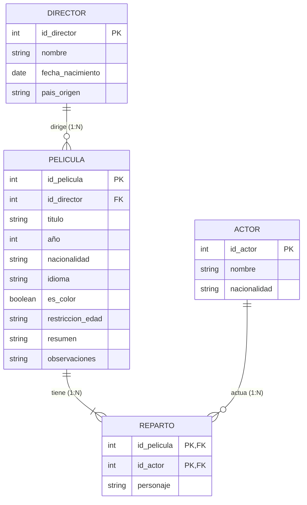

# TRABAJO PRÁCTICO Nº 3 - RESPUESTA 1

## Consigna: Ejercicio 1 (Colección de Películas)
> *Acabas de empezar tu colección de películas y quieres hacer una base de datos para construir su ficha técnica. De cada película, necesitas su título, año, nacionalidad y algunos datos de su director: el nombre, la fecha de nacimiento y su país de origen. Además, quieres saber su idioma, si es en blanco y negro o en color, si tiene alguna restricción de edad, un resumen y poder poner tus propias observaciones. La ficha técnica de cada película también debe incluir el reparto de actores, donde aparecerá su nombre, su nacionalidad y el nombre del personaje que tiene en la película. Diseñar una base de datos que se ajuste al requerimiento arriba expuesto, identificando tablas, atributos, claves principales y relaciones existentes.*

---

## 1. Identificación de Entidades (Tablas) y Atributos

### Tabla: `DIRECTOR`
Almacena los datos personales del director de la película.
* **`id_director`** (INT) — **Clave Primaria (PK)**: Identificador único del director.
* **`nombre`** (VARCHAR(100)): Nombre y apellido del director.
* **`fecha_nacimiento`** (DATE): Fecha de nacimiento.
* **`pais_origen`** (VARCHAR(50)): País de procedencia/origen.

---

### Tabla: `PELICULA`
Contiene la ficha técnica principal de cada película de la colección.
* **`id_pelicula`** (INT) — **Clave Primaria (PK)**: Identificador único de la película.
* **`id_director`** (INT) — **Clave Foránea (FK)**: Referencia al director de la película (`DIRECTOR.id_director`).
* **`titulo`** (VARCHAR(150)): Título de la obra.
* **`año`** (INT): Año de estreno/lanzamiento.
* **`nacionalidad`** (VARCHAR(50)): País de producción.
* **`idioma`** (VARCHAR(50)): Idioma original de la película.
* **`es_color`** (BOOLEAN): Indica si la película es en color (`TRUE`) o en blanco y negro (`FALSE`).
* **`restriccion_edad`** (VARCHAR(20)): Clasificación por edades (ej. "ATP", "+13", "+16", "+18").
* **`resumen`** (TEXT): Breve sinopsis argumental.
* **`observaciones`** (TEXT): Notas u observaciones personales del coleccionista.

---

### Tabla: `ACTOR`
Almacena la información de los actores que forman parte de los elencos.
* **`id_actor`** (INT) — **Clave Primaria (PK)**: Identificador único del actor.
* **`nombre`** (VARCHAR(100)): Nombre y apellido del actor.
* **`nacionalidad`** (VARCHAR(50)): Nacionalidad del actor.

---

### Tabla Intermedia: `REPARTO` (o `PELICULA_ACTOR`)
Representa la relación de muchos a muchos ($N:M$) entre Películas y Actores. Un actor puede actuar en varias películas interpretando distintos personajes, y una película cuenta con múltiples actores.
* **`id_pelicula`** (INT) — **Clave Primaria Compuesta / Clave Foránea (PK, FK)**: Referencia a `PELICULA.id_pelicula`.
* **`id_actor`** (INT) — **Clave Primaria Compuesta / Clave Foránea (PK, FK)**: Referencia a `ACTOR.id_actor`.
* **`personaje`** (VARCHAR(100)): Nombre del personaje interpretado en esa película específica (atributo propio de la relación).

---

## 2. Relaciones y Cardinalidades

1. **`DIRECTOR` - `PELICULA`**:
   * **Cardinalidad:** $1 : N$ (Uno a Muchos).
   * **Justificación:** Un director puede dirigir una o muchas películas ($1..N$). Cada película tiene un único director principal registrado ($1..1$).
   * **Implementación:** Se incluye `id_director` como clave foránea (FK) en la tabla `PELICULA`.

2. **`PELICULA` - `ACTOR` (a través de `REPARTO`)**:
   * **Cardinalidad:** $N : M$ (Muchos a Muchos).
   * **Justificación:** Una película tiene un reparto de varios actores ($1..N$), y un actor puede participar a lo largo de su carrera en múltiples películas ($0..N$).
   * **Implementación:** Se descompone la relación $N:M$ mediante la tabla asociativa `REPARTO`, cuya clave primaria es la combinación `(id_pelicula, id_actor)`.

---

## 3. Diagrama Visual (Mermaid)

---

## 4. Archivo para Draw.io
El archivo gráfico correspondiente listo para abrir en **[draw.io](https://app.diagrams.net)** se encuentra en esta misma carpeta:
* `respuesta1 tpN3.drawio`
